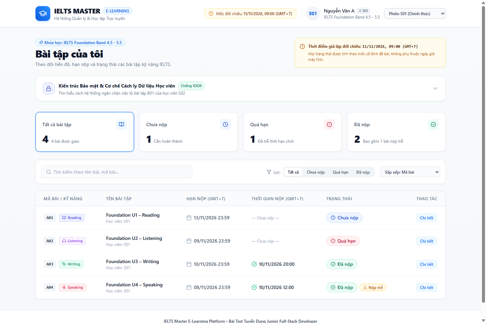

# IELTS MASTER | E-LEARNING
## BÀI TEST JUNIOR FULL-STACK DEVELOPER
### Chức năng: “Bài tập của tôi” (My Assignments)

Dự án được xây dựng bằng **Next.js 14 (App Router) + TypeScript + Tailwind CSS**, tích hợp đầy đủ API Route Handler, dịch vụ lọc dữ liệu cách ly theo phiên đăng nhập server, logic tính toán trạng thái bài tập theo mốc thời gian cố định **11/11/2026, 09:00 (GMT+7)** và bộ kiểm thử tự động (Automated Test Suite) đạt tỷ lệ **15/15 Tests Passed**.

---

## 📸 Ảnh chụp giao diện ứng dụng (Screenshot)



*Giao diện tương thích hoàn toàn trên Desktop (bảng dữ liệu, bộ lọc, thống kê) và Mobile (dạng thẻ chạm, tối ưu trải nghiệm đọc).*

---

## 🚀 1. Hướng dẫn cài đặt & Cách chạy ứng dụng

### Yêu cầu môi trường:
- **Node.js**: >= 18.x (khuyến nghị Node 20.x hoặc mới nhất)
- **Package Manager**: `npm`, `pnpm` hoặc `yarn`

### Các bước khởi chạy:
```bash
# 1. Cài đặt dependencies
npm install

# 2. Khởi chạy môi trường phát triển (Development)
npm run dev
```
Truy cập ứng dụng tại: [http://localhost:3000](http://localhost:3000)

### Hoặc chạy bản Production Build:
```bash
# Build mã nguồn
npm run build

# Khởi chạy production server
npm start
```

---

## 🧪 2. Hướng dẫn kiểm tra (Testing & Verification)

Dự án bao gồm bộ kiểm thử tự động toàn diện được viết bằng **Vitest** kiểm tra toàn bộ 4 trường hợp nghiệp vụ, các trường hợp biên và tính năng bảo mật cách ly dữ liệu.

### Chạy test tự động:
```bash
npm test
```

### Kết quả kiểm thử thực tế (15/15 tests PASS):
```
 ✓ tests/status-calculator.test.ts (8 tests)
   ✓ Trường hợp 1 (A01): Chưa nộp và còn hạn nộp -> "Chưa nộp"
   ✓ Trường hợp 2 (A02): Chưa nộp và đã hết hạn -> "Quá hạn"
   ✓ Trường hợp 3 (A03): Đã nộp trước hạn -> "Đã nộp"
   ✓ Trường hợp 4 (A04): Đã nộp sau hạn -> "Đã nộp" + "Nộp trễ"
   ✓ Nộp đúng vào giây cuối cùng của hạn nộp -> Đúng hạn
   ✓ Nộp trễ 1 phút so với hạn nộp -> "Nộp trễ"
   ✓ Mốc thời gian đúng bằng hạn nộp và chưa nộp -> "Chưa nộp"
   ✓ Mốc thời gian trễ hơn hạn nộp 1 giây và chưa nộp -> "Quá hạn"

 ✓ tests/assignment-service.test.ts (4 tests)
   ✓ Yêu cầu chính: Lọc đúng các bài tập của học viên S01, không lẫn B01 của S02
   ✓ Kiểm tra trạng thái hiển thị của từng bài tập theo kết quả cần đạt trong đề bài
   ✓ Kiểm tra cách ly dữ liệu: Học viên S02 chỉ xem được B01, không thấy bài của S01
   ✓ Kiểm tra phương thức getMyAssignments với session mặc định S01

 ✓ tests/api-route.test.ts (3 tests)
   ✓ API trả về danh sách bài tập của học viên S01 theo session server mặc định
   ✓ Bảo mật: Từ chối truy cập 403 Forbidden nếu client cố tình truyền ?studentId=S02 trong URL
   ✓ Bảo mật: Xác thực dựa trên session context chứ không phải URL param

Test Files  3 passed (3)
     Tests  15 passed (15)
```

### Kiểm tra thủ công qua API:
- **Kiểm tra dữ liệu S01 (hợp lệ)**:
  ```bash
  curl http://localhost:3000/api/assignments
  ```
  *Kết quả trả về danh sách 4 bài: `A01`, `A02`, `A03`, `A04`. Không có `B01`.*

- **Kiểm tra phòng thủ tấn công IDOR khi client cố tình truyền `?studentId=S02`**:
  ```bash
  curl http://localhost:3000/api/assignments?studentId=S02
  ```
  *Kết quả: Server trả về `HTTP 403 Forbidden` cùng thông báo từ chối truy cập trái phép dữ liệu học viên khác.*

---

## 🔒 3. Mô tả cách tránh lộ dữ liệu của học viên S02

Trong các ứng dụng E-Learning, việc rò rỉ dữ liệu giữa các học viên là lỗ hổng nghiêm trọng mang tên **IDOR (Insecure Direct Object Reference)** và **Broken Object Level Authorization (BOLA - OWASP Top 10 API #1)**.

Hệ thống trong bài làm giải quyết triệt để vấn đề này thông qua 3 lớp phòng thủ kiến trúc:

### 1. Phân giải danh tính hoàn toàn ở Server (Server-Side Session Resolution)
- **Quy tắc cốt lõi**: Server **tuyệt đối không tin cậy dữ liệu định danh do client gửi lên qua URL** (như query param `?studentId=S02` hay path param `/students/S02/assignments`).
- Thay vào đó, server tự xác thực và trích xuất danh tính học viên từ phiên đăng nhập an toàn (`getServerSession()`).
- Trong bài làm giả lập, server mặc định gắn kết phiên xác thực là học viên `S01`. Client không thể can thiệp làm thay đổi danh tính này chỉ bằng việc sửa đổi URL.

### 2. Ràng buộc phạm vi truy vấn ở tầng Service / Data (Row-Level Security Scope)
- Khi tầng Service (`AssignmentService.getAssignmentsByStudentId`) truy vấn danh sách bài tập, điều kiện lọc được ép buộc chặt chẽ:
  $$\text{WHERE } student\_id = \text{session.studentId}$$
- Dữ liệu của học viên `S02` (bài `B01`) hoàn toàn nằm ngoài tập kết quả ngay từ tầng logic dịch vụ, không bao giờ được nạp vào bộ nhớ chuẩn bị gửi về cho học viên `S01`.

### 3. Chủ động phát hiện và chặn hành vi can thiệp URL (Active Tampering Defense)
- Nếu một client đang xác thực dưới tài khoản `S01` nhưng lại cố tình gửi request kèm query param `?studentId=S02`, API Route Handler phát hiện sự sai lệch giữa `requestedStudentId` và `session.studentId`.
- Thay vì âm thầm trả về bài của S01 hoặc trả nhầm S02, hệ thống **ngay lập tức trả về mã lỗi HTTP 403 Forbidden**, ngăn chặn cuộc thăm dò và có thể kích hoạt ghi log giám sát an ninh.

---

## 📊 4. Bảng đối chiếu kết quả theo yêu cầu đề bài

Mốc thời gian giả lập cố định để đối chiếu: **11/11/2026, 09:00 (GMT+7)** (`2026-11-11T09:00:00+07:00`).

| Mã bài | Học viên | Tên bài tập | Hạn nộp (GMT+7) | Đã nộp (GMT+7) | Trạng thái hiển thị | Giải thích logic |
| :--- | :---: | :--- | :---: | :---: | :---: | :--- |
| **A01** | S01 | Foundation U1 – Reading | 13/11/2026 23:59 | — | `Chưa nộp` | Chưa nộp bài và thời điểm đối chiếu (11/11) vẫn còn hạn (trước 13/11). |
| **A02** | S01 | Foundation U2 – Listening | 09/11/2026 23:59 | — | `Quá hạn` | Chưa nộp bài và thời điểm đối chiếu (11/11) đã vượt quá hạn nộp (09/11). |
| **A03** | S01 | Foundation U3 – Writing | 10/11/2026 23:59 | 10/11/2026 20:00 | `Đã nộp` | Đã nộp bài lúc 20:00 ngày 10/11, trước hạn chót 23:59 cùng ngày (Đúng hạn). |
| **A04** | S01 | Foundation U4 – Speaking | 08/11/2026 23:59 | 10/11/2026 12:00 | `Đã nộp` + `Nộp trễ` | Đã nộp bài lúc 12:00 ngày 10/11, sau hạn chót 23:59 ngày 08/11 (Nộp trễ). |
| **B01** | **S02** | Foundation U1 – Reading | 13/11/2026 23:59 | — | **Bị ẩn hoàn toàn** | Thuộc về học viên S02; hệ thống cách ly tuyệt đối, S01 không xem được. |

---

## 📂 5. Cấu trúc mã nguồn (Project Structure)

```
IELTS_Master/
├── src/
│   ├── app/
│   │   ├── api/
│   │   │   └── assignments/
│   │   │       └── route.ts          # API Route Handler (Next.js server-side)
│   │   ├── globals.css               # Tailwind CSS & theme tokens
│   │   ├── layout.tsx                # Root layout metadata & fonts
│   │   └── page.tsx                  # Trang giao diện chính "Bài tập của tôi"
│   ├── components/
│   │   ├── AssignmentCard.tsx        # Card hiển thị bài tập tối ưu cho Mobile
│   │   ├── AssignmentDetailModal.tsx # Modal chi tiết bài tập & giải thích hạn nộp
│   │   ├── AssignmentTable.tsx       # Bảng bài tập cho Desktop kèm icon kỹ năng
│   │   ├── Header.tsx                # Header thanh điều hướng, user info & switcher
│   │   ├── SecurityNotice.tsx        # Khối thông tin kiến trúc bảo mật & live test IDOR
│   │   ├── StatsOverview.tsx         # Thống kê tổng số bài, chưa nộp, quá hạn, đã nộp
│   │   └── StatusBadge.tsx           # Badge trạng thái đa sắc màu trực quan
│   ├── lib/
│   │   ├── assignment-service.ts     # Tầng nghiệp vụ xử lý dữ liệu & lọc học viên
│   │   ├── constants.ts              # Hằng số mốc thời gian 11/11/2026 09:00 (GMT+7)
│   │   ├── mock-data.ts              # Dữ liệu giả lập mẫu (bao gồm S01 và S02)
│   │   ├── server-auth.ts            # Cơ chế trích xuất Session an toàn tại Server
│   │   └── status-calculator.ts      # Hàm tính toán logic trạng thái 4 trường hợp
│   └── types/
│       └── assignment.ts             # TypeScript definitions & domain interfaces
├── tests/
│   ├── api-route.test.ts             # Test API route handler & phòng thủ IDOR
│   ├── assignment-service.test.ts    # Test service lọc đúng S01 và loại trừ S02
│   └── status-calculator.test.ts     # Test logic trạng thái 4 trường hợp & biên
├── package.json                      # Cấu hình dự án & scripts (Next 14, Vitest, Tailwind)
├── tailwind.config.ts                # Cấu hình Tailwind colors & styling
├── tsconfig.json                     # Cấu hình TypeScript compiler
├── vitest.config.ts                  # Cấu hình test runner Vitest
├── screenshot.png                    # Ảnh chụp giao diện thực tế
└── README.md                         # Báo cáo & tài liệu hướng dẫn hoàn chỉnh
```

---

## 🔮 6. Phần chưa làm & Định hướng nâng cấp trong tương lai (Future Scope)

Trong phạm vi bài test tuyển dụng mini-project không sử dụng cơ sở dữ liệu thật hoặc VPS, bài làm tập trung vào nghiệp vụ cốt lõi “Bài tập của tôi” và cơ chế bảo mật cách ly dữ liệu. Dưới đây là các định hướng phát triển và nâng cấp hệ thống trong tương lai:

### A. Nâng cấp hạ tầng & Tính năng cốt lõi (Core Infrastructure & Features)
1. **Cơ sở dữ liệu & ORM thực tế**: Kết nối PostgreSQL thông qua Prisma/Drizzle ORM kèm thiết lập Row-Level Security (RLS) ở mức database.
2. **Xác thực phiên đầy đủ**: Tích hợp Auth.js (NextAuth) hoặc JWT mã hóa với cơ chế Refresh Token lưu trong HTTP-Only Secure Cookie.
3. **Nộp bài tập trực tiếp**:
   - Tải lên file ghi âm Speaking (`.mp3`, `.wav`) và file bài viết Writing (`.docx`, `.pdf`) lên S3/Cloud Storage.
   - Ghi nhận `submittedAt` tự động dựa trên thời gian server lúc nộp.
4. **Phân quyền người dùng (RBAC)**: Tách biệt quyền của Học viên (chỉ xem bài của mình), Giáo viên (xem và chấm bài của cả lớp), và Quản trị viên (Admin).

### B. Trợ lý AI & Tìm kiếm thông minh cho E-Learning (AI Tutor & Retrieval Pipeline)
• **Hỏi đáp thông minh với trợ lý AI (RAG - Retrieval-Augmented Generation)**: Cho phép học viên đặt câu hỏi bằng ngôn ngữ tự nhiên ngay trong trang học; hệ thống tìm kiếm nội dung liên quan trong tài liệu khóa học và tổng hợp câu trả lời dựa trên tài liệu được truy xuất.
• **Minh bạch dữ liệu & trích dẫn nguồn (Citations & References)**: Hiển thị nguồn tham chiếu cho mỗi câu trả lời: tên tài liệu, chương, trang hoặc đoạn nội dung.
• **Cá nhân hóa lộ trình học & ôn tập thích ứng (Adaptive Learning)**: Gợi ý câu hỏi tiếp theo và giải thích lại kiến thức theo mức độ cơ bản, trung bình, nâng cao. Chức năng tạo câu hỏi ôn tập được triển khai ở mức minh họa; nếu còn đủ thời gian, nhóm đánh giá bổ sung tính đúng đắn, độ rõ ràng và mức độ phù hợp với nội dung tài liệu.
• **Nghiên cứu & tối ưu hóa phương pháp truy xuất (Search & Retrieval Pipeline)**: Nghiên cứu, cài đặt và so sánh các phương pháp truy xuất: BM25, vector search, hybrid search (BM25 + vector) và hybrid search có reranking.
• **Đánh giá & An toàn AI (Evaluation, Guardrails & Security)**: Đánh giá hiệu quả của AI bằng các chỉ số định lượng về truy xuất và chất lượng câu trả lời; kiểm soát nội dung AI sinh ra, hạn chế hallucination và bảo vệ dữ liệu học viên.

